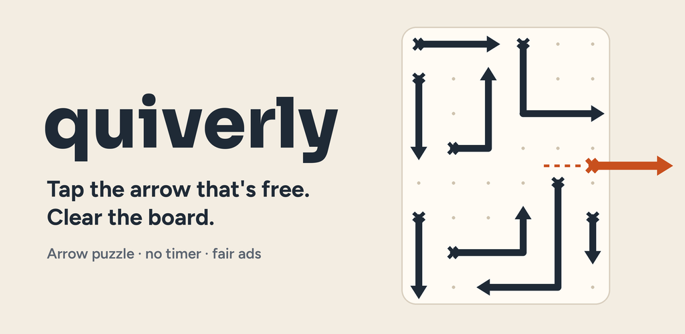
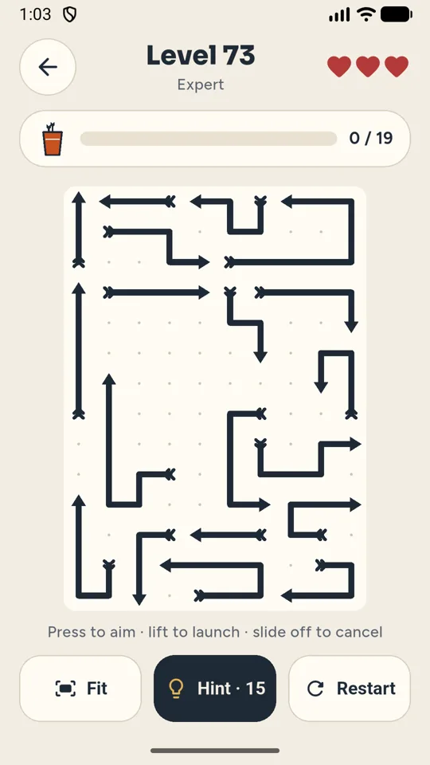
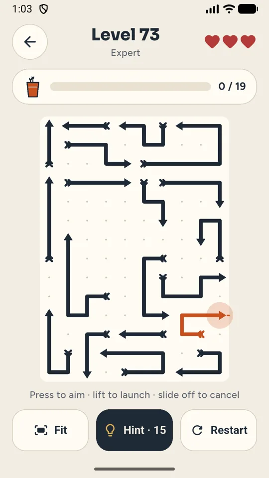
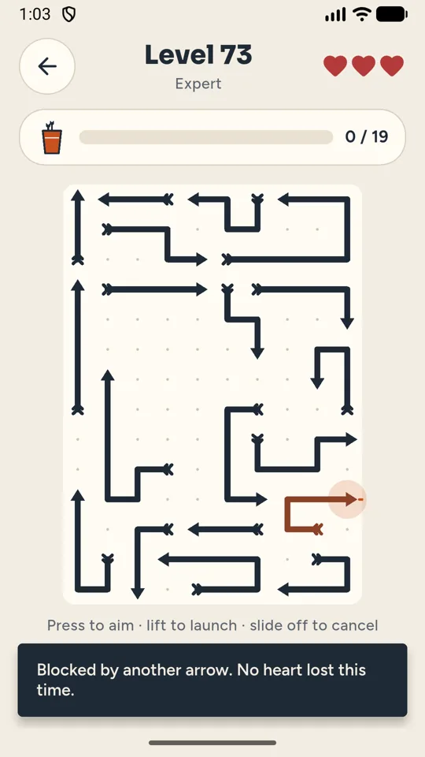
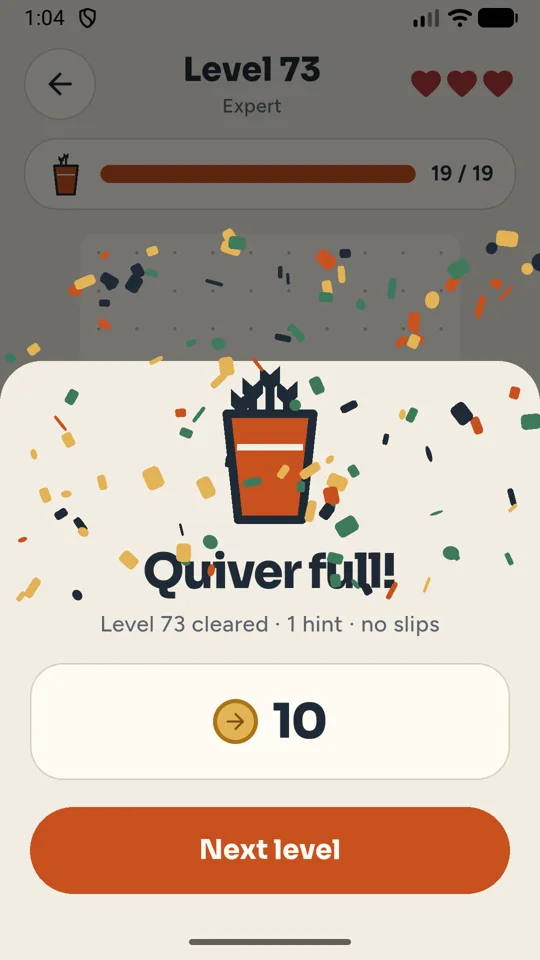

# Quiverly: Arrow Puzzle Escape

A free arrow puzzle for Android: tap arrows out of the board in the right order, with no lost lives for mis-taps and no timer.

<a href="https://play.google.com/store/apps/details?id=com.nktools.quiverly&utm_source=github&utm_medium=readme"><b>Get it on Google Play</b></a> · <a href="https://quiverly.pages.dev/">Website</a> · <a href="https://nookeshkarri7.github.io/quiverly-arrow-puzzle/">About page</a>

## How it plays

- **Press to aim, lift to launch.** Pressing an arrow shows its exit line first. Slide off to cancel.
- **Mis-taps don't cost you.** Quiverly picks the arrow nearest your touch, and the first slip on every level is free.
- **Boards fit your screen.** No panning. Pinch to zoom on a busy corner, tap Fit to see it all.
- **Fresh levels.** Every board is generated new and grows from a few straight arrows to dense, twisting logic puzzles.
- **Hints, daily puzzle, check-in.** Earn coins by playing for hints; a daily puzzle that gets harder through the week.
- **Calm by design.** No timer, plays offline, no account. Light and dark themes.

Free, no purchases. Supported by optional videos and an occasional ad between levels, never in the middle of one.

## Links

- Google Play: https://play.google.com/store/apps/details?id=com.nktools.quiverly
- Website: https://quiverly.pages.dev/
- Privacy policy: https://quiverly.pages.dev/privacy/
- Teaser video: https://youtu.be/aZe--UaPo8M
- Contact: anithabheesetty@gmail.com

© 2026 NK Tools. All rights reserved.
